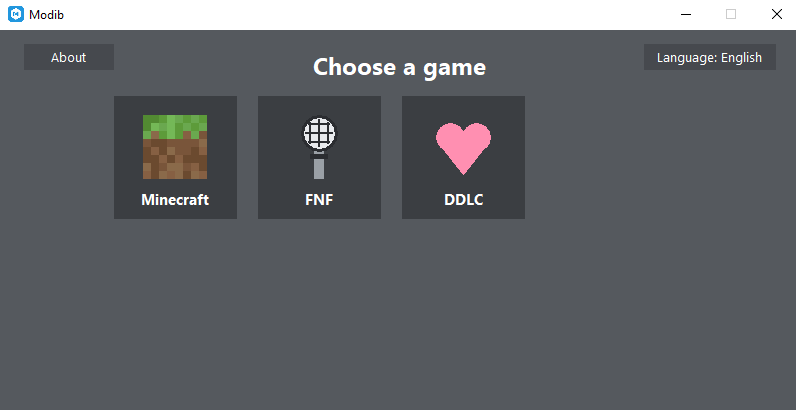
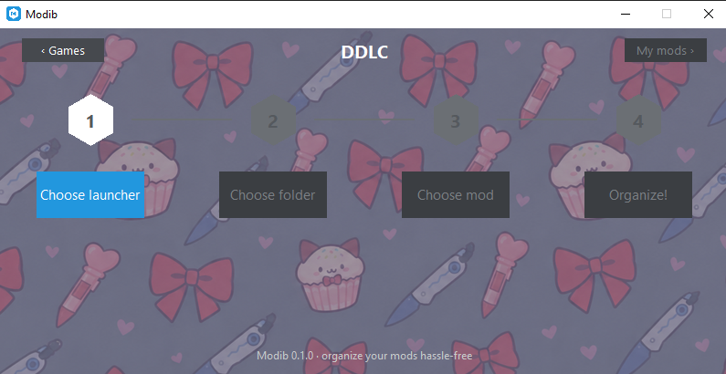

# Modib

[English](README.md) · **Español** · [Português](README.pt.md)

Un organizador de mods sencillo para Windows. Eliges el juego, el launcher y el mod, pulsas **¡Organizar!** y Modib lo pone todo en su sitio.

> ⚠️ **Beta.** Modib es joven. Pruébalo primero con una copia de tus juegos y cuéntame qué falla.




## Juegos compatibles

| Juego | Qué es un mod | Activar / desactivar | Notas |
|---|---|---|---|
| **Minecraft** | un archivo `.jar` | sí | Funciona con el Launcher oficial, Prism Launcher, TLauncher, SKLauncher, Modrinth App, CurseForge y Feather Client. Te dice qué loader necesita el mod (Fabric, Forge, NeoForge, Quilt). |
| **Friday Night Funkin'** | una carpeta o un `.zip` | sí | Los mods van a la carpeta `mods` del juego; los desactivados pasan a `mods_desactivados`. |
| **Doki Doki Literature Club** | un `.zip` o una carpeta | borrar la copia | Cada mod tiene **su propia copia** del juego limpio, así que nunca se mezclan. Reconoce mods clásicos, modernos (con su `.exe`) e independientes, y complementos como skins. |

Más juegos podrían llegar más adelante.

## Cómo se usa

1. Descarga `Modib.exe` desde la página de [Releases](../../releases) y ábrelo. La primera vez te pregunta el idioma (English, Español o Português).
2. Elige el juego y el launcher. Modib encuentra la carpeta del juego solo; si no puede, hay un botón para **buscar automáticamente**, o puedes elegirla a mano.
3. Elige tu mod (un `.zip`, una carpeta, o un `.jar` en Minecraft).
4. Pulsa **¡Organizar!**
5. Abre **Mis mods** para activar, desactivar, jugar o eliminar mods.

Modib recuerda las carpetas que elegiste.

## Doki Doki Literature Club en detalle

- Usa una **copia limpia** del juego descargada de la web oficial. La versión de Steam suele fallar con mods, y Modib te avisa si parece esa.
- Cada mod se instala en `DDLC Mods\<nombre del mod>`, al lado de tu juego limpio. Tu juego limpio nunca se modifica.
- Pulsa **Jugar** en *Mis mods* para abrir un mod (usa el `.exe` propio del mod si lo trae).
- Las skins, los regalos y los submods son *complementos*: Modib pregunta en la copia de qué mod ponerlos. No se pueden quitar uno por uno; elimina esa copia y vuelve a instalarla sin ellos.
- Cada copia es un juego completo, así que ocupa unos cientos de MB. Modib te dice el tamaño antes de copiar.
- Solo se admiten archivos `.zip` y carpetas. Si es un `.rar` o `.7z`, descomprímelo antes.

## Conviene saber

- **Solo Windows.** Escrito en Python con Tkinter, sin librerías extra.
- **Modib nunca se conecta a internet.** No descarga juegos, mods ni loaders; los pones tú.
- **No instala** Fabric, Forge ni otros loaders. En Minecraft, el perfil de tu launcher debe usar el mismo loader y la misma versión de Minecraft que el mod.
- Los mods son programas que se ejecutan en tu PC. Descárgalos solo de sitios de confianza.
- Modib solo escribe en su carpeta `Modib datos`, en las carpetas de juego que elijas y en `DDLC Mods`.
- Si algo falla, los detalles se guardan en `Modib datos\errores.log`.
- **Avisos del antivirus o de SmartScreen:** el `.exe` está hecho con PyInstaller y no está firmado, así que Windows o tu antivirus pueden decir que es desconocido. El código está aquí: puedes leerlo, o crear tú mismo el `.exe` con `crear_exe.bat` (necesita `pip install pyinstaller`).

## Ejecutarlo desde el código

```
python interfaz.py
```

Necesitas Python 3 para Windows con Tkinter (viene en el instalador normal). La carpeta `assets` tiene que estar junto a `interfaz.py`.

## Avisar de un problema

Abre un [issue](../../issues/new/choose). Incluye la versión de Modib (botón **Acerca de**), tu juego y launcher, y el archivo `Modib datos\errores.log` si existe (revísalo antes: tiene nombres de carpetas de tu PC).

## Sin afiliación

Modib es un proyecto de la comunidad. **No está afiliado ni respaldado por** Mojang, Microsoft, Team Salvato, los creadores de Friday Night Funkin' ni ningún launcher o mod mencionado. Todos los nombres y marcas pertenecen a sus dueños.

## Licencia

[MIT](LICENSE). Los dibujos de `assets` y el icono de la aplicación los hizo <tu nombre> para este proyecto.
