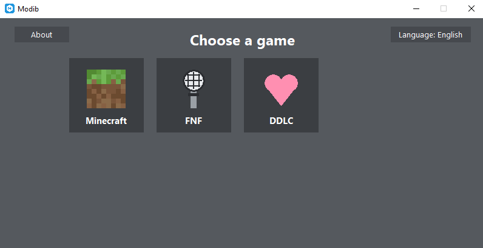
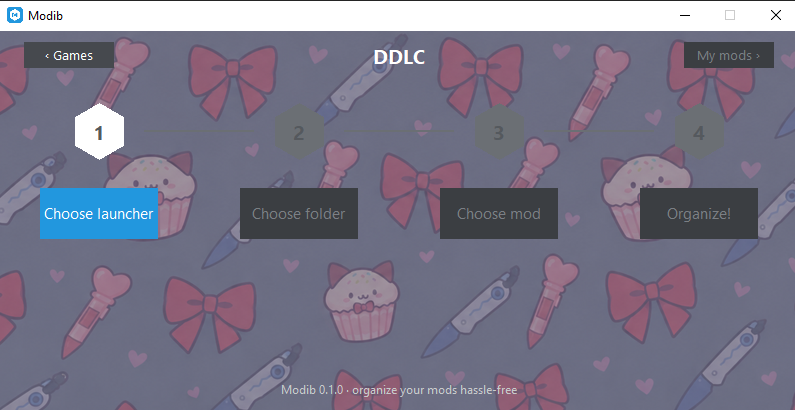

# Modib
Organize your mods hassle-free

**English** · [Español](README.es.md) · [Português](README.pt.md)

A simple mod organizer for Windows. Pick your game, pick your launcher, pick your mod, and press **Organize!** — Modib puts everything in the right place.

> ⚠️ **Beta.** Modib is young. Try it with a copy of your games first and tell me what breaks.




## Supported games

| Game | What a mod is | Enable / disable | Notes |
|---|---|---|---|
| **Minecraft** | a `.jar` file | yes | Works with the official Launcher, Prism Launcher, TLauncher, SKLauncher, Modrinth App, CurseForge and Feather Client. Tells you which loader the mod needs (Fabric, Forge, NeoForge, Quilt). |
| **Friday Night Funkin'** | a folder or a `.zip` | yes | Mods go in the game's `mods` folder; disabled mods move to `mods_desactivados`. |
| **Doki Doki Literature Club** | a `.zip` or a folder | delete the copy | Every mod gets **its own copy** of the clean game, so mods never mix. Detects classic, modern (own `.exe`) and standalone mods, and add-ons such as skins. |

More games may come later.

## How to use

1. Download `Modib.exe` from the [Releases](../../releases) page and open it. The first time it asks for your language (English, Español or Português).
2. Pick a game, then your launcher. Modib finds the game folder by itself; if it can't, there is a **search automatically** button, or you can choose the folder by hand.
3. Choose your mod (a `.zip`, a folder, or a `.jar` for Minecraft).
4. Press **Organize!**
5. Open **My mods** to enable, disable, play or delete mods.

Modib remembers the folders you chose.

## Doki Doki Literature Club in detail

- Use a **clean copy** of the game downloaded from the official site. The Steam version often fails with mods, and Modib warns you if it looks like that one.
- Each mod is installed in `DDLC Mods\<mod name>`, next to your clean game. Your clean game is never changed.
- Press **Play** in *My mods* to open a mod (it uses the mod's own `.exe` when it has one).
- Skins, gifts and submods are *add-ons*: Modib asks which mod's copy to put them in. They can't be removed one by one; delete that copy and install again without them.
- Each copy is a full game, so it takes a few hundred MB. Modib tells you the size before copying.
- Only `.zip` files and folders are supported. For `.rar` or `.7z`, extract them first.

## Good to know

- **Windows only.** Written in Python with Tkinter, no extra libraries.
- **Modib never connects to the internet.** It doesn't download games, mods or loaders. You bring your own.
- It **does not install** Fabric, Forge or other loaders. For Minecraft, your launcher profile must use the same loader and Minecraft version as the mod.
- Mods are programs that run on your PC. Download them only from sites you trust.
- Modib only writes in its own `Modib datos` folder, in the game folders you choose, and in `DDLC Mods`.
- If something fails, details are saved in `Modib datos\errores.log`.
- **Antivirus / SmartScreen warnings:** the `.exe` is built with PyInstaller and is not code-signed, so Windows or your antivirus may say it is unknown. The source is here: you can read it, or build the `.exe` yourself with `crear_exe.bat` (it needs `pip install pyinstaller`).

## Run it from the source

```
python interfaz.py
```

You need Python 3 for Windows with Tkinter (it is included in the standard installer). The folder `assets` must stay next to `interfaz.py`.

## Reporting problems

Open an [issue](../../issues/new/choose). Please include your Modib version (the **About** button), your game and launcher, and the file `Modib datos\errores.log` if there is one (check it first: it contains folder names from your PC).

## Not affiliated

Modib is a community project. It is **not affiliated with or endorsed by** Mojang, Microsoft, Team Salvato, the creators of Friday Night Funkin', or any launcher or mod mentioned here. All names and trademarks belong to their owners.

## License

[MIT](LICENSE). Artwork in `assets` and the app icon were made for this project by <your name>.
