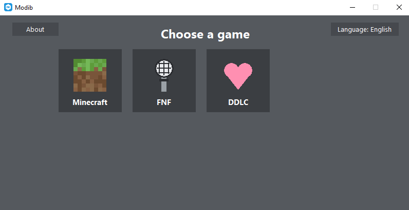
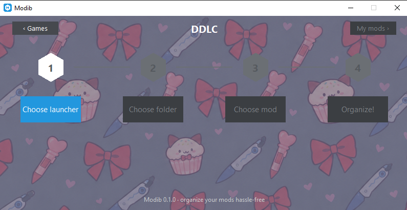

# Modib

[English](README.md) · [Español](README.es.md) · **Português**

Um organizador de mods simples para Windows. Você escolhe o jogo, o launcher e o mod, clica em **Organizar!** e o Modib coloca tudo no lugar certo.

> ⚠️ **Beta.** O Modib é novo. Teste primeiro com uma cópia dos seus jogos e me conte o que der errado.




## Jogos compatíveis

| Jogo | O que é um mod | Ativar / desativar | Observações |
|---|---|---|---|
| **Minecraft** | um arquivo `.jar` | sim | Funciona com o Launcher oficial, Prism Launcher, TLauncher, SKLauncher, Modrinth App, CurseForge e Feather Client. Mostra qual loader o mod precisa (Fabric, Forge, NeoForge, Quilt). |
| **Friday Night Funkin'** | uma pasta ou um `.zip` | sim | Os mods vão para a pasta `mods` do jogo; os desativados vão para `mods_desactivados`. |
| **Doki Doki Literature Club** | um `.zip` ou uma pasta | excluir a cópia | Cada mod tem **a sua própria cópia** do jogo limpo, então os mods nunca se misturam. Reconhece mods clássicos, modernos (com `.exe` próprio) e independentes, e complementos como skins. |

Mais jogos podem chegar no futuro.

## Como usar

1. Baixe o `Modib.exe` na página de [Releases](../../releases) e abra. Na primeira vez ele pergunta o idioma (English, Español ou Português).
2. Escolha o jogo e depois o launcher. O Modib encontra a pasta do jogo sozinho; se não conseguir, há um botão para **procurar automaticamente**, ou você pode escolher a pasta manualmente.
3. Escolha o seu mod (um `.zip`, uma pasta ou, no Minecraft, um `.jar`).
4. Clique em **Organizar!**
5. Abra **Meus mods** para ativar, desativar, jogar ou excluir mods.

O Modib lembra as pastas que você escolheu.

## Doki Doki Literature Club em detalhe

- Use uma **cópia limpa** do jogo baixada do site oficial. A versão do Steam costuma dar erro com mods, e o Modib avisa se parecer essa.
- Cada mod é instalado em `DDLC Mods\<nome do mod>`, ao lado do seu jogo limpo. O seu jogo limpo nunca é alterado.
- Clique em **Jogar** em *Meus mods* para abrir um mod (usa o `.exe` próprio do mod, se ele tiver).
- Skins, presentes e submods são *complementos*: o Modib pergunta em qual cópia de mod colocá-los. Não dá para removê-los um a um; exclua essa cópia e instale de novo sem eles.
- Cada cópia é um jogo completo, então ocupa algumas centenas de MB. O Modib mostra o tamanho antes de copiar.
- Só são aceitos arquivos `.zip` e pastas. Se for `.rar` ou `.7z`, descompacte antes.

## Bom saber

- **Só Windows.** Escrito em Python com Tkinter, sem bibliotecas extras.
- **O Modib nunca se conecta à internet.** Ele não baixa jogos, mods nem loaders; você traz os seus.
- Ele **não instala** Fabric, Forge nem outros loaders. No Minecraft, o perfil do seu launcher precisa usar o mesmo loader e a mesma versão do Minecraft que o mod.
- Mods são programas que rodam no seu PC. Baixe-os só de sites confiáveis.
- O Modib só escreve na própria pasta `Modib datos`, nas pastas de jogo que você escolher e em `DDLC Mods`.
- Se algo falhar, os detalhes ficam em `Modib datos\errores.log`.
- **Avisos do antivírus ou do SmartScreen:** o `.exe` é feito com PyInstaller e não é assinado, então o Windows ou o antivírus podem dizer que é desconhecido. O código está aqui: você pode lê-lo ou criar o `.exe` você mesmo com `crear_exe.bat` (precisa de `pip install pyinstaller`).

## Rodar a partir do código

```
python interfaz.py
```

Você precisa do Python 3 para Windows com Tkinter (já vem no instalador padrão). A pasta `assets` deve ficar junto do `interfaz.py`.

## Relatar um problema

Abra uma [issue](../../issues/new/choose). Inclua a versão do Modib (botão **Sobre**), o seu jogo e launcher, e o arquivo `Modib datos\errores.log`, se existir (confira antes: ele tem nomes de pastas do seu PC).

## Sem afiliação

O Modib é um projeto da comunidade. Ele **não é afiliado nem endossado por** Mojang, Microsoft, Team Salvato, pelos criadores de Friday Night Funkin' nem por nenhum launcher ou mod citado. Todos os nomes e marcas pertencem aos seus donos.

## Licença

[MIT](LICENSE). Os desenhos de `assets` e o ícone do aplicativo foram feitos por <seu nome> para este projeto.
